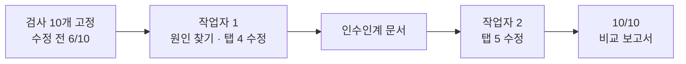

# aleph-mk5 · 두 AI 이어받기 실험

SK ALEPH 부트캠프 실습 (2026-10-20 ~ 10-30). [aleph-mk3](https://github.com/mdkk0220/aleph-mk3) 팬카드 스튜디오의 "템플릿이 새로고침하면 사라지는" 문제를, AI 작업자 1이 시작하고 작업자 2가 인수인계 문서만 받아 이어서 고치게 한 뒤 측정값으로 비교했습니다.

> 결과: 고정 검사 10개 **수정 전 6/10 → 작업자 1 종료 10/10 → 작업자 2 종료 10/10**



코드 읽기와 수정, 검사 작성, 결과 검증은 AI가 했습니다. 고칠 기능 선택, 두 번째 작업자 선택, 태그가 가리킬 커밋 지정은 직접 했습니다. 자세한 구분은 보고서 6절에 있습니다.

| 문서 | 내용 |
|---|---|
| [비교 보고서](public/report.html) | 작업 시간 · 호출 수 · 검사 결과 비교, AI와 나의 판단 |
| [HANDOFF.md](HANDOFF.md) | 작업자 1이 남긴 인수인계 문서 |
| [checks/](checks/) | 고정 검사 명세(`SPEC.md`), 실행기, 작업 기록(`RECORD.md`) |

```bash
npm install && npm run build
npx vite preview --port 4173 &
node checks/run.cjs     # Playwright 필요, 마지막 줄 PASS 10/10
```
