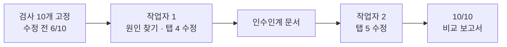

# MK5 · 두 AI 이어받기 실험

[고친 앱 바로 보기](https://aleph-mk1020.vercel.app) · [비교 보고서](https://aleph-mk1020.vercel.app/report.html) · 2026-10-20 ~ 10-30 · React 18, Vite, Playwright

[MK3](../MK3_fancard-studio/) 팬카드 스튜디오에는 템플릿이 새로고침하면 사라지는 문제가 있었습니다. 이걸 고치면서 질문 하나를 같이 확인해 봤습니다. AI 작업자 하나가 일을 하다 멈추고, 다른 AI 작업자가 인수인계 문서만 받아 이어서 하면 결과가 유지될까?

결과는 고정 검사 10개 기준으로 수정 전 6/10, 작업자 1 종료 시 10/10, 작업자 2 종료 시 10/10이었습니다.



## 실험 설계

- 검사 10개(`checks/SPEC.md`)를 코드 수정 전에 먼저 만들고 커밋했습니다. 고친 코드에 맞춰 검사를 짜는 일을 막기 위해서입니다.
- 두 작업자 모두 시간 90분, 요청 · 도구 호출 30회를 상한으로 같게 뒀습니다.
- 작업자 1은 탭 4만 고치고 멈췄고, 그 시점 커밋에 `a-stop` 태그를 붙였습니다. 작업자 2는 다른 모델로 골랐고, 이 태그와 `HANDOFF.md`만 보고 탭 5를 이어서 고쳤습니다.
- 새 폴더에 처음부터 받아서 빌드하고 검사를 다시 돌려, 기록에 적힌 결과가 재현되는지 확인했습니다.

## 원인과 수정

MK3는 Claude 아티팩트 화면 안에서만 있는 저장 기능(`window.storage`)을 썼고, 일반 브라우저에는 이 기능이 없어서 저장이 항상 실패했습니다. `src/storage.js`를 새로 만들어 `window.storage`가 있으면 그걸 쓰고, 없으면 `localStorage`를 쓰게 했습니다. 탭 4와 탭 5가 모두 이 파일을 거치게 바꿨습니다.

## 역할 구분

이 실험은 AI 작업자끼리의 인수인계를 보는 것이라 역할을 그대로 적었습니다.

| 직접 판단한 일 | AI 작업자에게 맡긴 일 |
| --- | --- |
| 고칠 기능 선택, 레포와 프로젝트 이름, 레포 생성과 업로드, 두 번째 작업자로 다른 모델 선택, 태그가 가리킬 커밋 지정 | 코드 읽기와 원인 찾기, 검사 10개 초안과 실행기 작성, 저장소 어댑터 구현, 인수인계 문서 작성, 결과 검증 |

태그는 도구가 현재 main 기준으로 만들자고 제안했지만, 인수인계 문서에 적힌 버전 ID와 맞추려고 해당 커밋을 직접 지정했습니다. 자세한 내용은 비교 보고서 6절에 있습니다.

## 문서

| 문서 | 내용 |
| --- | --- |
| [비교 보고서](public/report.html) | 작업 시간, 호출 수, 검사 결과 비교와 판단 |
| [HANDOFF.md](HANDOFF.md) | 작업자 1이 남긴 인수인계 문서 |
| [checks/](checks/) | 고정 검사 명세(`SPEC.md`), 실행기, 작업 기록(`RECORD.md`) |

## 검사 재현

```bash
npm install && npm run build
npx vite preview --port 4173 &
node checks/run.cjs     # Playwright 필요, 마지막 줄 PASS 10/10
```
