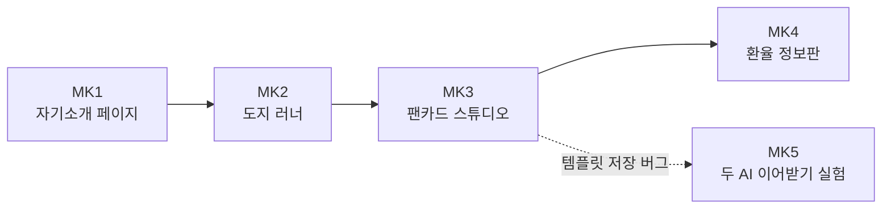

# SK-ALEPH · 부트캠프 실습 모음

> SK ALEPH 부트캠프(2026-09 ~ 10)에서 진행한 실습 5개를 한곳에 모은 레포입니다.
> 처음에는 실습마다 레포를 따로 만들었다가(`aleph-mk` ~ `aleph-mk5`), **커밋 이력을 그대로 보존**한 채 이 레포 하나로 합쳤습니다.

`HTML` `CSS` `JavaScript` `React 18` `Vite` `localStorage`

## 실습 목록

| 번호 | 주제 | 기간 | 사용 기술 | 한 줄 설명 |
| --- | --- | --- | --- | --- |
| MK1 | [자기소개 웹 페이지](./MK1_intro-page/) | 2026-09-08 | HTML · CSS | 기술 스택과 팀 프로젝트 2개를 상황 · 행동 · 결과 순서로 정리한 한 장짜리 페이지 |
| MK2 | [도지 러너](./MK2_dodge-runner/) | 2026-09-09 | HTML · CSS · JavaScript | 떨어지는 장애물을 피해 30초 버티는 8비트 게임. 난이도 · 기록 저장, CSV 내보내기 |
| MK3 | [팬카드 스튜디오](./MK3_fancard-studio/) | 2026-09-14 | React · Vite | 문구 · 크기 · 색 · 비율을 정해 팬카드를 만드는 앱. 극단 입력 12건 검증 |
| MK4 | [오늘의 환율 정보판](./MK4_exchange-rate-board/) | 2026-09-15 | HTML · CSS · JavaScript | 출처 · 조회 시각과 함께 환율을 보여 주고, 실패 상황 5가지를 재현 |
| MK5 | [두 AI 이어받기 실험](./MK5_ai-handoff-experiment/) | 2026-10-20 ~ 10-30 | React · Vite | MK3의 버그를 두 작업자가 인수인계 문서로 이어서 고치고 측정값으로 비교 (검사 6/10 → 10/10) |

## 실습 사이의 연결



- 화살표는 진행한 날짜 순서입니다.
- MK5는 MK3에 남아 있던 "새로고침하면 템플릿이 사라지는" 문제를 이어서 고친 실험입니다.

## 실행 방법

| 실습 | 방법 |
| --- | --- |
| MK1, MK2, MK4 | 폴더의 `index.html`을 브라우저로 열기 |
| MK3, MK5 | 폴더에서 `npm install` → `npm run dev` |

## 폴더 구성

```text
SK-ALEPH/
├── README.md                       # 전체 목록 (이 문서)
├── MK1_intro-page/                 # 이전 aleph-mk
├── MK2_dodge-runner/               # 이전 aleph-mk2
├── MK3_fancard-studio/             # 이전 aleph-mk3
├── MK4_exchange-rate-board/        # 이전 aleph-mk4
└── MK5_ai-handoff-experiment/      # 이전 aleph-mk5
```

## 이력에 대해
- `git subtree`로 합쳐서 원래 레포의 커밋이 그대로 남아 있습니다. `git log -- MK3_fancard-studio`처럼 폴더별 이력을 볼 수 있습니다.
- MK5 문서에 나오는 태그 `a-stop`도 같은 커밋을 가리키도록 옮겼습니다.
- 합치기 전과 커밋 ID가 같아서, MK5 기록에 나오는 커밋 ID(`c79bcc8`, `fcc3330` 등)는 이 레포에서 그대로 찾을 수 있습니다.
