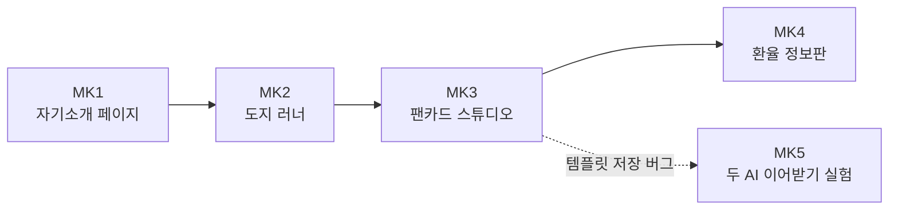

# SK-ALEPH · 부트캠프 실습 모음

SK ALEPH 부트캠프(2026년 9 ~ 10월)에서 만든 웹 실습 다섯 개입니다. 한 장짜리 HTML 페이지로 시작해서 React 앱을 만들었고, 마지막에는 그 앱의 버그를 고치는 과정을 검사 수치로 기록했습니다. 모두 Claude와 대화하면서 만들었고, 무엇을 만들지와 어떻게 확인할지는 직접 정했습니다.

`HTML` `CSS` `JavaScript` `React 18` `Vite` `Playwright` `Vercel`

## 실습 목록

| 번호 | 주제 | 날짜 | 기술 | 내용 | 바로 보기 |
| --- | --- | --- | --- | --- | --- |
| MK1 | [자기소개 웹 페이지](./MK1_intro-page/) | 09-08 | HTML · CSS | 프로젝트 세 개를 상황 · 행동 · 결과로 정리하고 근거 링크를 붙인 페이지 | [열기](https://aleph-mk0908.vercel.app) |
| MK2 | [도지 러너](./MK2_dodge-runner/) | 09-09 | JavaScript | 30초 버티기 게임. 저장값이 깨져도 멈추지 않게 처리하고, 기록은 CSV로 내보내기 | [플레이](https://aleph-mk0909.vercel.app) |
| MK3 | [팬카드 스튜디오](./MK3_fancard-studio/) | 09-14 | React · Vite | 미리보기와 저장된 PNG가 똑같이 나오게 맞춘 카드 편집기. 극단 입력 12가지 처리 | [열기](https://aleph-mk0914.vercel.app) |
| MK4 | [오늘의 환율 정보판](./MK4_exchange-rate-board/) | 09-15 | JavaScript | 환율과 함께 출처 · 시각을 보여 주고, 실패 다섯 가지를 재현하는 페이지 | [열기](https://aleph-mk0915.vercel.app) |
| MK5 | [두 AI 이어받기 실험](./MK5_ai-handoff-experiment/) | 10-20 ~ 10-30 | React · Playwright | MK3의 템플릿 저장 버그를 고치며, AI 작업자 교대 후에도 결과가 유지되는지 측정 (검사 6/10 → 10/10) | [열기](https://aleph-mk1020.vercel.app) · [보고서](https://aleph-mk1020.vercel.app/report.html) |



실선은 만든 순서이고, 점선은 MK5가 MK3의 문제를 이어서 고쳤다는 뜻입니다.

## 실습마다 공통으로 챙긴 것

기능을 만든 뒤에는 실패하는 경우를 일부러 만들어서 확인했습니다. MK2는 깨진 저장값을 넣는 버튼, MK3는 극단 입력 12가지, MK4는 실패 응답 다섯 가지를 재현하는 버튼, MK5는 코드를 고치기 전에 먼저 고정한 검사 10개가 그 예입니다. 각 폴더 README에 무엇을 확인했는지 적어 두었습니다.

## 직접 실행하기

| 실습 | 방법 |
| --- | --- |
| MK1, MK2, MK4 | 폴더의 `index.html`을 브라우저로 열기 |
| MK3, MK5 | 폴더에서 `npm install` 후 `npm run dev` |

## 폴더 구성

```text
SK-ALEPH/
├── README.md
├── MK1_intro-page/
├── MK2_dodge-runner/
├── MK3_fancard-studio/
├── MK4_exchange-rate-board/
└── MK5_ai-handoff-experiment/
```

처음에는 실습마다 레포를 따로 만들었다가(`aleph-mk` ~ `aleph-mk5`), 커밋 이력을 그대로 둔 채 이 레포로 합쳤습니다. 커밋 ID가 바뀌지 않아서 MK5 기록에 나오는 커밋(`c79bcc8`, 태그 `a-stop`)도 이 레포에서 찾을 수 있습니다. 폴더별 이력은 `git log -- MK3_fancard-studio`처럼 볼 수 있습니다.
